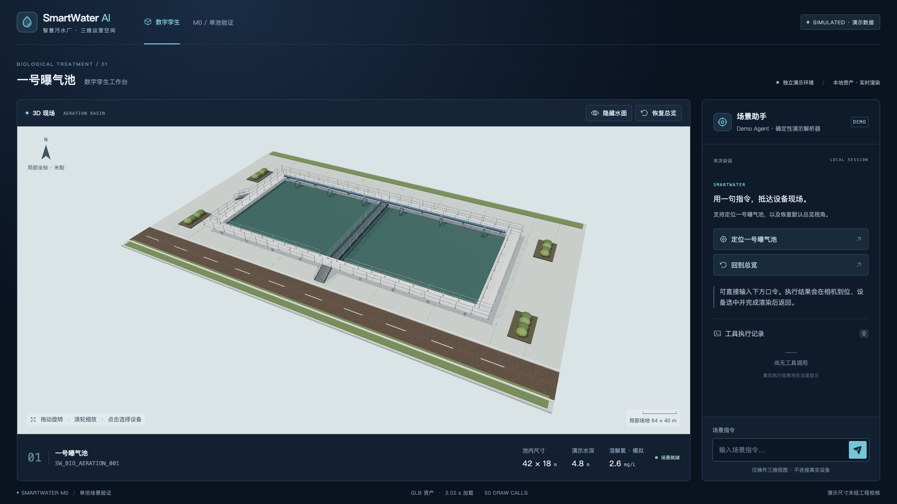
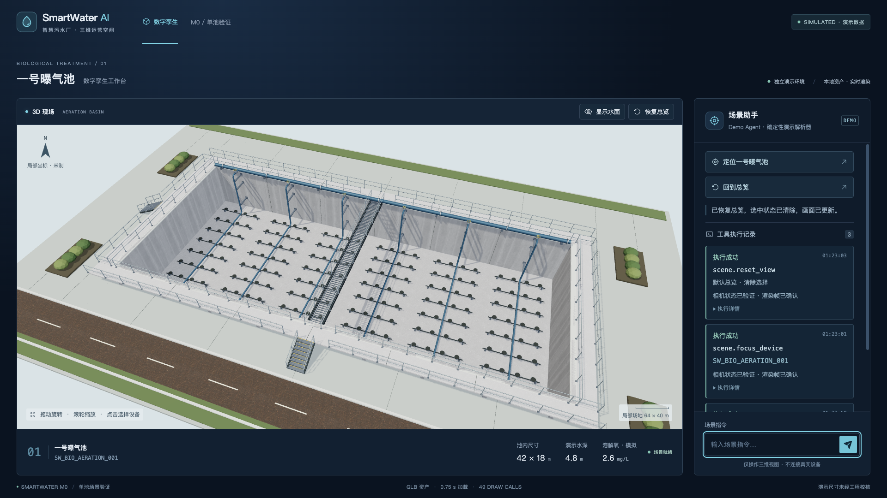
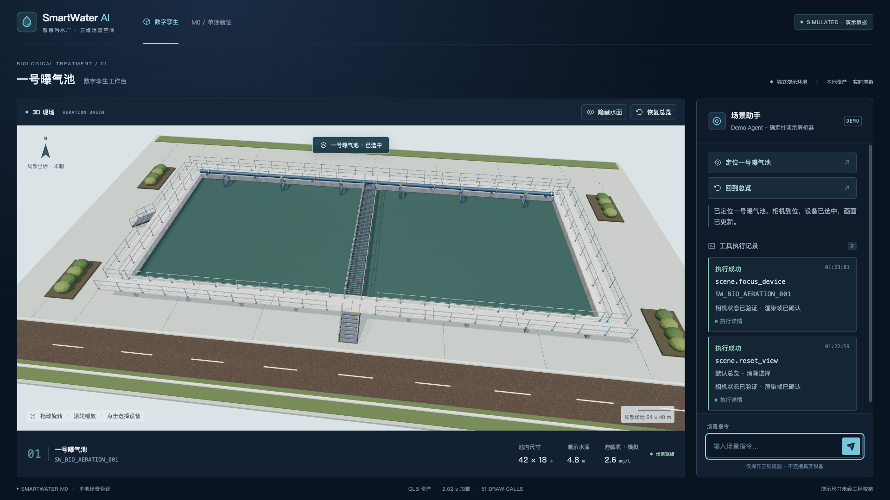

# SmartWater M0.1 视觉修正交付

日期：2026-11-16（Asia/Shanghai）。范围仅为混凝土、选中效果、水纹、相机构图与文字五项修正。没有进入 M1，没有新增设备、Agent 工具、后端或真实大模型。

**M0.1 视觉修正已交付，等待用户视觉验收。** 技术检查不代表用户已经认可最终视觉。

## 交付与修改前保护

- 实际预览地址：<http://127.0.0.1:4173/>；启动命令 `pnpm preview`。页面已停留在普通生产入口，未暴露 QA 诊断接口。
- 原工作区没有提交，项目文件处于未跟踪状态；本轮没有提交、重置、清理 Git、添加远程或推送，也没有修改全局身份。
- 修改前 Git 状态、43 条文件摘要见 [baseline/state.json](baseline/state.json)。本轮涉及的原实现、配置、源资产、生产文件已备份至 [baseline/m0-before.tar.gz](baseline/m0-before.tar.gz)，原生产文件另存 `baseline/site/`。备份不含 node_modules、密钥或其他项目。
- 恢复时应先将归档解压到另一个目录核对，再按需恢复指定文件；本轮没有执行覆盖式恢复。原测试文件未纳入该归档，不能将归档称为整个工作区的完整备份。
- 原参考图、首轮失败基线及清单中的旧证据共 30 个受保护文件，最终均按原 SHA-256 核对，内容未变。原 M0 截图的严格构建关联仍为“关联关系未验证”，没有倒推补证。
- Blender 仅通过独立后台进程生成、保存和验证项目资产；没有调用当前交互 Blender 的清空、删除或修改场景操作。

## 五项修正与证据

### 1. 混凝土条带与板纹

实际原因：原基础色照片自带高反差、偏棕的模板条带，原法线与粗糙度也保留同方向板缝。池壁与底板共用 `Concrete / board formed · 4m`，约 43.4 m 长的底板 UV 跨 10.85 次重复，条带被机械铺满池底。基础色 sRGB、法线和粗糙度 Non-Color 原本正确，因此没有把问题归因于错误色彩空间。通道原为另一种简单预制材质。证据见 [通道检查](channel-inspection.json)、[原 Blend 材质与 UV](material-diagnosis.json)。

修改：引入已解码、登记许可的混凝土地面扫描，分为池壁、池底、走道三种用途。墙体减弱原模板对比并混合细颗粒，保留淡模板痕迹；池底和走道采用各自中性基础色。墙体纹理尺度仍为 4 m，池底/走道为 2 m；法线强度分别为 0.18/0.24/0.12。基础色 2K，法线/粗糙度 1K；粗糙度保持哑光。没有通过整体变暗、加污渍或改变曝光处理。

可复现源：`scripts/blender/visual_materials.py`、`scripts/blender/build_aeration.py`、`config/aeration.json`；已同步生成可编辑 Blend 与 GLB。不是网页临时替换。通道及颜色空间检查见 [material-after.json](material-after.json)。

固定视角对比：[修改前](final/material-before.png) · [修改后](final/material-after.png)；另见 [混凝土近景](final/concrete-closeup.png)、[连接近景](final/connections-closeup.png)。前后均在本轮冻结查看器中加载已校验的旧/新 GLB，使用同一相机、视口、DPR、光照，并隐藏水面。

已验证：网页实际加载嵌入纹理，原池底连续板条不再出现，墙体仍有较淡的模板变化；50 个网格的顶点位置与修改前一致。仍存在：广角下池底颗粒较细、走道较干净，墙体重复痕迹没有完全消除；自然程度与强度待用户判断。

### 2. 长方体辅助框感

实际原因：原 `src/scene/runtime.ts` 使用 `THREE.Box3Helper` 表示选中，设备真实范围包括地下池底，因而产生从池顶贯穿到地下的线框盒。它属于可见选中 UI，不只是取景数据。

修改：保留 Box3 和共享设备注册表用于实际范围/取景；移除默认可见 Box3Helper。改为池沿上方的四组短角标和一个设备标签。角标对象是场景独立节点，不挂入设备层级，不参与设备拾取，不影响取景包围盒。没有新增后处理链。

取消、超时、重新加载和复位会移除并释放角标；使用选择代次防止旧操作清掉新操作的选择。重复定位保持一个角标对象/一个标签。

对比：[原 M0 定位截图，仅作视觉参考](../agent-focused.png) · [本轮定位完成](final/agent-focused.png) · [本轮复位](final/agent-reset-overview.png)。原图未补造严格构建关联，且相机/UI 已变化，因此这组不用于材质定量对比。

已验证：重复定位、同设备连续命令、普通点击、用户拖动取消、超时、加载中断、复位后标签/效果数量正确，失败/取消不返回成功。见 [15 项浏览器回归](browser-tests.json)、[3 项额外清理检查](visual-cleanup-regression.json)。仍存在：短角标刻意较淡，在缩略图中不突出；可辨识性等待用户视觉验收。

### 3. 水面规则斜纹

实际原因：原 256×256 法线由少数定向周期波构成，2 m UV 平铺放大了单方向等间距纹理。原法线的前 12 个频率峰占去中心化 XY 信号能量约 99.92%，与截图条纹方向吻合；这是法线内容与尺度共同造成的问题，不是靠增加透明度可以解决的。

修改：以固定种子 4107 生成 512×512、多尺度各向同性周期噪声高度梯度法线，纹理尺度 6 m；保留原不透明水色和已有平稳 UV 动画，粗糙度 0.27。新图自身梯度幅度低于旧图，因此节点强度 0.42 不能与旧 0.12 脱离法线内容直接比较。新图前 12 峰能量占比约 3.39%。没有新增流体模拟、镜面系统、发光或透视池底效果。

固定相机、水纹相位 0、同视口/光照对比：[修改前](final/water-before.png) · [修改后](final/water-after.png)。原始频谱记录在 [material-diagnosis.json](material-diagnosis.json)，新结果在 [material-after.json](material-after.json)。

已验证：近景等间距斜纹不再可见，存在克制的细小不规则变化；连续相机性能采样期间原有水纹动画正常运行。普通隐藏水面功能仍能检查全部曝气盘。仍存在：远景水纹很轻，反射和粗糙度是否满足审美需要用户确认；未声称完成真实水动力验证。

### 4. 总览主体偏下、上方留白

实际原因：原总览固定相机 `[42,39,53]`、目标 `[0,-0.5,0]`，没有按实际三维 canvas 的透视投影居中。用新 GLB 在旧相机重现时，场地投影 top≈0.488、bottom≈-1.024（NDC，边界 ±1），上方留白多且近端场地越界。

修改：新增 `src/scene/framing.ts`，以实际 canvas 宽高比计算场地包围盒投影、迭代居中并拟合总览；聚焦另外按设备真实包围盒计算，使用不同观察方向与边距。没有修改真实模型尺寸。总览 resize 后更新默认状态；复位恢复新的相机、target、zoom 并清除选择。

单独构图对比：[旧相机 + 新 GLB](final/overview-old-camera.png) · [新相机 + 同一新 GLB](final/overview-new-camera.png)。这组变化只用于说明构图，不能称为材质改善。

已验证：1920×1080 实际三维区 1440×659，新总览场地投影上下约 ±0.87；1366×768 三维区 989×434 也约 ±0.87，保留场地边界。总览/聚焦有明显差异，复位实际返回新默认。两项相机单元测试与浏览器恢复断言通过。仍存在：聚焦会有意裁掉部分周边道路，主要池体保留；小尺寸下细构件需要缩放近看。

### 5. 工具记录及辅助文字偏小

实际原因：原 CSS 中状态约 10 px、工具名 11 px、设备 ID 9 px、结果 10 px、执行详情 9 px；小桌面侧栏有大量说明挤占记录空间。

修改：状态、工具名、完整设备 ID 提至 14 px，结果 13 px，详情 12 px，输入 14 px；设备 ID 和 JSON 可换行。存在记录时收起重复介绍，1366 桌面快捷操作并为两列，记录区滚动、输入区保留。保留“执行成功/执行失败/已取消”文字与对应详情，没有只靠颜色表达状态。

对比：[原 M0 定位截图，仅作视觉参考](../agent-focused.png) · [本轮定位与记录](final/agent-focused.png) · [1366×768](final/layout-1366.png)。原图与新图构图不同，不能据此作整体像素差分。

已验证：两个尺寸下输入、关键状态、设备 ID 可读，无整页缩放或页面横向溢出；展开详情仍保留完整 action_id、参数、时间和 result/error。仍存在：时间戳与次要辅助文字保留 11–12 px；小桌面历史记录需要滚动，未将所有内容同时摊开。

## 最终网页截图

以下优先审阅 `final/`，全部来自实际运行的冻结生产网页，DPR=1。没有使用 AI 图片、Blender 渲染或参考图替代。

| 证据 | 截图 |
| --- | --- |
| 1920×1080 总览 | [overview-1920.png](final/overview-1920.png) |
| 混凝土及连接细节 | [concrete-closeup.png](final/concrete-closeup.png)、[connections-closeup.png](final/connections-closeup.png) |
| 水面近景 | [water-closeup.png](final/water-closeup.png) |
| 隐藏水面与曝气装置 | [aerators-water-hidden.png](final/aerators-water-hidden.png) |
| Agent 定位及执行记录 | [agent-focused.png](final/agent-focused.png) |
| 恢复总览及清除选择 | [agent-reset-overview.png](final/agent-reset-overview.png) |
| 1366×768 布局 | [layout-1366.png](final/layout-1366.png) |
| 固定镜头材质前后 | [before](final/material-before.png)、[after](final/material-after.png) |
| 固定镜头水面前后 | [before](final/water-before.png)、[after](final/water-after.png) |
| 相机构图单独对比 | [old camera](final/overview-old-camera.png)、[new camera](final/overview-new-camera.png) |







## 本轮构建与截图关联

冻结时间：2026-11-15 17:07:51 UTC（北京时间 11 月 16 日 01:07:51）。构建之后只采集/验证，没有再修改 dist。构建 ID 为下列 7 个生产文件路径、字节数、SHA-256 清单的摘要，不冒充 Git commit：

```text
build_id  37e8f64e201b2dcc4cf59ace9043bd509f999e5beb9e5bd94b802d3db06f4810
GLB       5fed509ce0989a1bfd321ec6be8c445643892a1ed2a5dfad990123b3f1468d1f
Blend     0d25407693ddb3039c99796e6a01467c91a318ce74028b1e5083a1bb56e23796
旧 GLB    03d18ce77b0b2f641ba5e0784ec34c622edce3eb795e43e4c0236777c6f2f857
```

[build-identity.json](build-identity.json) 保存 HTML、JS、CSS、GLB、HDR、favicon 和仅用于对比的旧 GLB 摘要；`dist/build-id.json` 与其相同。旧 GLB 在冻结前复制到 `dist/qa-assets/m0-before.glb`，普通页面始终加载新 GLB。

[final/screenshots-manifest.json](final/screenshots-manifest.json) 对 14 张图逐张记录：PNG SHA-256、UTC 时间、CSS 视口、DPR、camera/target/FOV/zoom、选中设备、水面状态/相位、光照和构建 ID。每张图采集时均核对浏览器实际响应的入口 JS/CSS 摘要，以及 GLBLoader 实际取回字节的 SHA-256。所有关联检查通过。相机与纹理对比所用光照均为曝光 1.05、太阳强度 2.6、环境强度 0.48、2048 阴影图；没有用换光照冒充材质改善。

交付前最终校验见 [final-integrity.json](final-integrity.json)：30 个受保护旧文件、7 个冻结生产文件、14 张 PNG 及其浏览器资源关联、固定相机前后状态、Blend/GLB 摘要与重启记录均通过核对。机器可读交付摘要见 [summary.json](summary.json)，逐文件修改前后 SHA-256 与新增文件清单见 [file-changes.json](file-changes.json)。

材质对比相机 `[10,31,28]`，target `[0,-2.3,0]`；水面对比相机 `[-9,5.7,15]`，target `[-8,0.5,2]`。相应前后图的这些状态逐字段相同，水纹相位为 0。除被比较 GLB 的材质/UV/水纹不同外，几何顶点位置相同。细节视角不是总览，因此局部场地裁切不作为总览问题。

目录根部的首批截图、`iteration-*` 与 `ui-step-old-material.png` 也保留；部分早期截图页脚统计尚未刷新，不作为最终统计证据。最终 `final/` 额外等待渲染和页脚 draw calls 一致再截图。没有删除或覆盖旧 M0 证据。

## 资产与可复现源文件

新外部资源仅为 [Poly Haven concrete_floor_01](https://polyhaven.com/a/concrete_floor_01)，作者 Rob Tuytel，[CC0](https://polyhaven.com/license)。下载三张实际 2048×2048 JPG，逐一 MD5/SHA-256 校验和完整解码，见 [downloaded-resources.json](downloaded-resources.json)。下载时间、文件名、通道和哈希记录在项目 [asset-register.json](../../asset-register.json)。没有登录、购买或下载失败后冒充完成。

源资产产物：

- `assets/source/aeration-tank.blend`：29,154,960 字节，可编辑、贴图已打包。
- `public/models/aeration-tank.glb`：31,254,844 字节，约 31.25 MB / 29.81 MiB。较原 24,080,432 字节增加 7,174,412 字节，主要因用途分离的贴图；未引入压缩解码链。
- 50 个网格，106,042 三角形，192 个曝气盘，尺寸、半埋地结构和场地开口不变。设备根 `SW_BIO_AERATION_001` 唯一，场地独立根，水面独立节点，默认 Cube/Camera/Light 未导出。
- 3 张下载源图；8 张可复现派生图：`concrete_{wall,floor}_r1_{diff,nor_gl,rough}.png`、`concrete_walkway_r1_diff.png`、`water_normal_r1.png`。原扫描贴图和旧水纹未删除。派生图的作者、源文件、通道/分辨率/哈希同样登记。

实际修改的已有文件：

- 查看器/UI：`src/scene/runtime.ts`、`src/App.vue`、`src/styles.css`。
- 资产：`config/aeration.json`、`scripts/blender/build_aeration.py`、`scripts/blender/validate_asset.py`、`assets/source/aeration-tank.blend`、`public/models/aeration-tank.glb`、`docs/asset-register.json`。
- 验收/说明：`scripts/browser-acceptance.mjs`、`scripts/browser-performance.mjs`、`scripts/browser-restart-check.mjs`、`README.md`。
- 生成的生产文件：`dist/index.html`、新 JS/CSS、模型；原 bundle 已在基线归档和 `baseline/site` 中保留。

实际新增的实现/辅助文件：`src/scene/framing.ts`、`tests/framing.test.ts`、`scripts/blender/visual_materials.py`、`scripts/blender/inspect_visual_materials.py`、`scripts/download_visual_r1.py`、`scripts/freeze_visual_r1.py`、`scripts/browser-visual-evidence.mjs`。本目录新增截图、日志、摘要和报告；没有额外证据服务。

未修改：`package.json`、`pnpm-lock.yaml`、Action Dispatcher、确定性解析器、设备注册表、相机执行器；原四项单元断言仍在，新增两项投影断言，没有删除测试规避问题。依赖版本未升级。

## 回归、资产验证与重启

| 检查 | 实际结果与证据 |
| --- | --- |
| TypeScript | `pnpm typecheck` 通过，[日志](typecheck.log) |
| 生产构建 | `pnpm build` 通过，[日志](build.log)；仍有约 771 KB JS chunk 超 500 KB 提示，没有隐藏警告 |
| 单元测试 | `pnpm test`，6/6 通过，[日志](unit-tests.log) |
| 浏览器回归 | 15/15 通过，[browser-tests.json](browser-tests.json) |
| 额外视觉清理 | 用户取消、加载中断、超时 3/3，选中对象/标签清理且旧动作不报成功，[记录](visual-cleanup-regression.json) |
| Blend 重新打开 | 独立后台进程打开成功，场景 `SmartWater_M0`，52 个受管对象，图像全打包 |
| GLB 独立重新导入 | 成功，有限顶点/法线、无退化面、设备根唯一、地面开口正确，[model-validation.json](model-validation.json) |
| 几何保护 | 50/50 网格 POSITION 原始值摘要与旧 GLB 相同，最终新旧 GLB SHA 已绑定，[geometry-preservation.json](geometry-preservation.json) |
| 重启 | 停止本项目旧 preview 并重新 `pnpm preview`；QA 和普通生产入口实际 focus/reset 成功，普通入口无诊断全局，[restart-browser.json](restart-browser.json)、[普通生产截图](restart-normal-production.png) |

浏览器覆盖：两条真实口令、未知口令不产生调用、重复 action_id 幂等、设备不存在、加载未完成、404、非法 GLB、普通重试、超时、快速连续指令、用户拖动中断、普通点击与 Agent 共用选择、地面遮挡、隐藏水面、重复选择及复位清理。成功记录均有实际 camera/target、selected_id、rendered_frame 和 arrival_verified，没有改为固定延时成功。

重启后的一个记录样本：GLB 获取/解析约 1.680 s，首个模型渲染约 2.117 s；常规浏览器首次回归样本约 2.765 s / 3.133 s。缓存、DPR和测试时机不同，不将这些单样本称为冷启动性能基准。

复现命令（会生成新产物，不能用于在本轮冻结截图中途改产物）：

```bash
python3 scripts/download_visual_r1.py
pnpm model:build
pnpm model:validate
pnpm typecheck
pnpm test
pnpm build
pnpm preview
```

本轮已实际执行上述建模、验证、类型、构建和测试步骤。固定构建后只重启 preview，没有重建。截图/浏览器脚本使用现有 ego-browser，没有安装测试浏览器或升级依赖。

## 连续移动性能：保留全部样本

实际 Apple M3，ANGLE Metal / WebGL2，macOS，Chromium 156.0.8078.96；1920×1080 CSS，三维 canvas 1440×659。每次资源就绪，先两次预热移动，再由同一个 CameraController 连续移动至少 60 秒；页面全程 visible，采样中无截图或页面轮询。记录真实帧时间数组，不用瞬时 FPS。阴影、光照、曝光一致。普通生产渲染 DPR 上限为 1.5；DPR=2 试验通过 QA 明确设置实际 renderer DPR=2，未把设备 DPR 与渲染 DPR 混淆。

| 样本 | 采样秒数 / 帧数 | 平均 FPS | P95 / P99 帧时 ms | >33.34ms 帧数 | 开始时页面焦点 | 本样本判定 |
| --- | --- | --- | --- | --- | --- | --- |
| 新 GLB，DPR=1 | 63.183 / 3345 | 52.94 | 32.9 / 81.6 | 146 | 有 | 达到平均≥30 且 P95≤33.34ms |
| 新 GLB，DPR=2，首测 | 66.315 / 2144 | 32.33 | 100.1 / 168.6 | 456 | 无 | 未达到稳定帧时目标 |
| 旧 GLB，同 r1 查看器，DPR=1 | 63.498 / 3011 | 47.42 | 50.0 / 98.7 | 252 | 有 | 未达到稳定帧时目标 |
| 新 GLB，DPR=2，聚焦页面复测 | 62.532 / 3439 | 55.00 | 31.8 / 51.7 | 120 | 有 | 本次达到样本目标 |

原始数组和条件：[DPR=1](performance-dpr1.json)、[DPR=2 首测未达标](performance-dpr2-unfocused.json)、[旧 GLB 对照](performance-old-glb-dpr1.json)、[DPR=2 复测](performance-dpr2.json)。绘制调用均为 50；选中时因角标增加到 51，隐藏水面时为 49。新资产运行纹理计数 15，旧资产对照 11。

**性能限制未消除：** 新 DPR=1 样本达到上述统计阈值，但仍有 P99 长帧；DPR=2 首测明显不稳定，必须与复测同时阅读。作为排查，在同一 r1 查看器换回旧 GLB 也出现长帧；不能据此将问题确定为新材质的 GPU 开销，也不能声称本轮带来性能提升。开始时焦点与浏览器调度是观察到的条件差异，未做隔离因果实验，窗口焦点未连续记录。全程 visibility 已记录。单次 M0 短测与本轮长测条件不同，不能直接当严格退化百分比。所有样本分辨率相同，没有降分辨率掩盖问题。普遍稳定 30 FPS、其他设备/浏览器、长时间内存行为仍未验证。

## 完成边界

已实现：五项范围内修正、同步源资产及 GLB、可重复构建、同构建网页证据。设备 ID、尺寸、曝气装置、两个工具、隐藏水面、SIMULATED 和 Demo Agent 标识保留。

已验证：上述构建/类型/6 单元/15 浏览器/3 清理检查、独立 Blend/GLB 检查、资源重载与 preview 重启、本轮 14 张截图关联。技术结论以各项证据的范围为限。

未完全验证：不同机器、Safari/其他浏览器、生产网络传输、长期内存与所有运行条件下稳定帧时；旧 M0 截图的严格构建关联。没有接入真实设备，也未做工程设计校核。

待用户视觉验收：混凝土模板痕迹与颗粒强度、水纹克制程度、角标可辨识性、新构图和文字层级。不会自行宣布视觉通过。本轮到此停止，不扩展完整厂区。

**M0.1 视觉修正已交付，等待用户视觉验收。**
