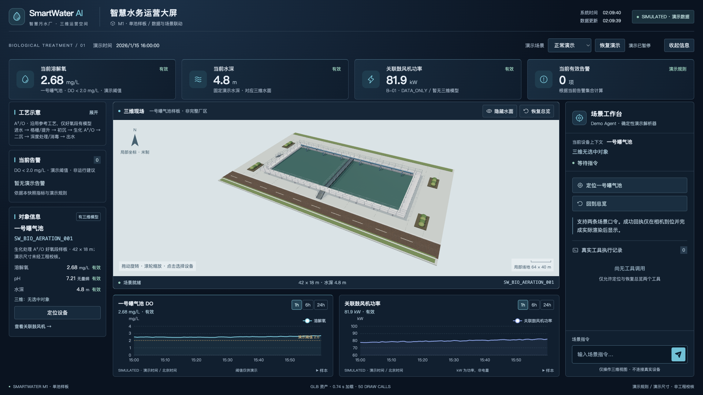
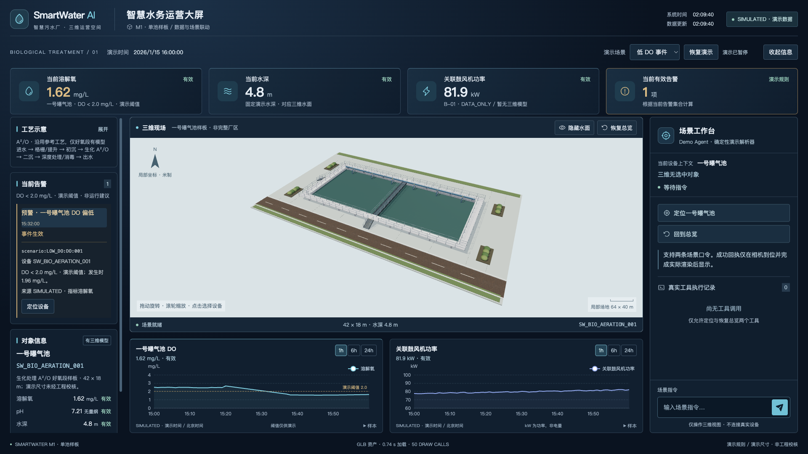
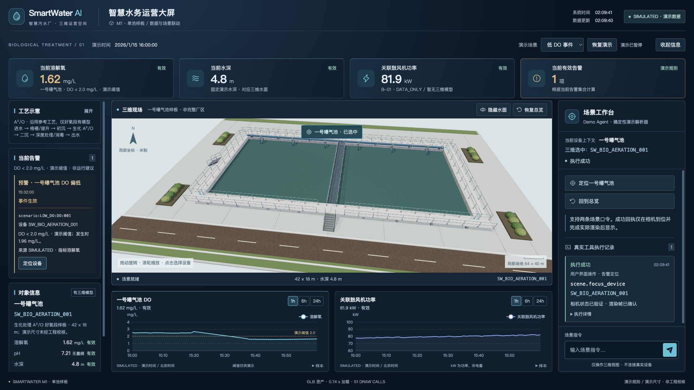

# SmartWater M1 验收报告

日期：2026-11-16（Asia/Shanghai）。**M1 实施已交付，等待用户体验验收。**

本轮在 M0.1 上增量完成工业大屏、统一模拟数据、工艺/设备/告警/趋势与场景联动。技术检查结果不等于用户已认可最终视觉和使用体验。到 M1 停止，没有进入 M2。

## 范围和基线

- 保留唯一三维设备 `SW_BIO_AERATION_001`、半埋地尺寸、材质、水面、角标和标签。没有修改 Blend、GLB、建模脚本、参考图、M0/M0.1 旧截图或失败基线；没有操作交互 Blender。
- 模型范围明确写为“一号曝气池样板 · 非完整厂区”。B-01 只有 DATA_ONLY 功率数据和文字说明，没有占位模型。
- 只保留 `scene.focus_device`、`scene.reset_view`。没有真实 LLM、API Key、工业控制、后端、数据库、工单或诊断/优化按钮。
- 原 AGENTS.md 的 M0 阶段上限由本轮用户明确授权的 M1 范围覆盖，其余保护约束继续执行；原指令文件保留。
- 开工 Git 状态为原有未跟踪文件，没有提交；本轮没有重置、清理、推送或更改全局配置。[baseline.json](baseline.json) 记录修改前状态和摘要，[m0.1-frontend-before.tar.gz](m0.1-frontend-before.tar.gz) 备份原前端、测试、脚本、配置与生产文件。恢复应先解压到独立目录检查，不直接覆盖用户工作区。
- 108 个记录在案的受保护文件交付前重新校验，内容均未变。可编辑 Blend 和 GLB 与 M0.1 字节相同，本轮无需重做或重新导出模型。

## 实际启动方式

运行中的固定生产预览：<http://127.0.0.1:4173/>，命令 `pnpm preview`。普通入口默认运行 NORMAL 场景，每 5 秒发布模拟快照；没有 QA 全局接口。

```bash
# 已有依赖；在需要重新安装时使用现有项目本地 store
pnpm install --frozen-lockfile --store-dir .pnpm-store
pnpm dev
# 开发地址 http://127.0.0.1:5173/

pnpm typecheck
pnpm test
pnpm build
pnpm preview
```

本轮使用现有 Node 24.21.0、pnpm 11.25.0、Vue 3.5.45、TypeScript 5.9.3、Vite 8.3.8。仅新增锁定的 ECharts 6.0.0 及其两个必要依赖，没有升级原依赖。初次安装因 store 路径不一致被 pnpm 拒绝，改用原 `.pnpm-store` 参数后成功，没有修改全局 store。记录见 [dependency-compatibility.json](dependency-compatibility.json)。

ECharts 使用 [官方按需导入方式](https://echarts.apache.org/handbook/en/basics/import/)，仅注册折线、坐标网格、图例、提示、演示阈值、ARIA 和 SVG renderer；没有导入地图或三维图表。SVG/DOM 保留浏览器原生清晰度，只有 Three.js drawing buffer 默认倍率设为 1。

## 页面与代码组织

App.vue 负责装配，不再承载整个查看器和工作台模板。没有另建场景、注册表或日志系统。

| 职责 | 实际文件 |
| --- | --- |
| 布局和页头 | `DashboardShell.vue`、`DashboardHeader.vue` |
| KPI、工艺、对象和告警 | `KpiOverview.vue`、`ProcessFlowPanel.vue`、`DeviceSummary.vue`、`AlarmPanel.vue` |
| 三维容器 | `SceneViewport.vue`，包装原 `src/scene/runtime.ts`，只挂载一次 |
| 趋势 | `TrendPanel.vue`、`src/charts/runtime.ts`，按快照更新并复用实例 |
| 常驻 Agent | `AgentWorkspace.vue`，输入、当前上下文、状态、记录和参数/结果/错误详情 |
| 共享状态 | `useSceneWorkspace.ts`、`useMockData.ts`、`useDashboardContext.ts`，沿用 Vue 组合式状态，没有引入 Pinia |
| 唯一模拟数据 | `src/data/mockDataProvider.ts` |
| 仅验收接口 | `src/qa/exposeDashboardQA.ts`，普通生产入口不暴露 |

1920×1080 下为四 KPI、左信息、中央三维及双趋势、右侧工作台。1366×768 默认收起左信息，趋势用标签/展开抽屉，保留场景和输入区，没有整页 transform 缩放。工艺示意默认折叠以让告警和对象信息可见，可展开查看已有名称及“示意 / 未建模”标记；它不是工艺设计或仿真。展开较长告警详情时左侧允许内部滚动。

实例不进入深度响应树：Three runtime 使用 shallowRef，图表实例为组件局部变量，数据快照也是 shallowRef。只有一套三维 animation loop；数据刷新与面板开合不重新加载 GLB。图表 ResizeObserver 处理可见尺寸，隐藏容器不创建/更新，重新可见时 resize 并补最新快照；销毁时断开 observer、取消排队回调并 dispose。图表动画关闭，不每帧刷新。

## 数据口径与演示规则

完整说明见 [data-rules.md](data-rules.md)。版本 `smartwater-m1.1`、固定种子 4107、演示起点 `2026-01-15T08:00:00Z`（北京时间 16:00）。系统时间、演示时间、数据更新时间分别标注。

- `MockDataProvider` 唯一生成 KPI、详情、趋势和告警。每条读数含 scopeType/scopeId/metricKey/value/unit/observedAt/quality/source/snapshotId，另有 sampleAt 时间槽。source 固定 SIMULATED，quality 独立为 GOOD/MISSING/STALE。
- DO mg/L、pH 无量纲、水深 m、关联鼓风机功率 kW。水深始终为 4.8，与现有三维水面一致；没有动态水位控制。功率不冒充全厂能耗或 kWh 电量。
- 历史只有同一份 24h 数据（1441 点），1h/6h/24h 是截取，分别为 61/361/1441 点。当前 DO/功率直接引用历史末点，详情与 KPI 不再另造数值。
- NORMAL：GOOD、零告警。LOW_DO：当前 DO 约 1.62，产生 WARNING。MISSING_DATA：DO/pH null，功率 STALE，显示“—”及质量，图表保留 null 断点，不补零；低 DO 告警仍为 AWAITING_DATA，不自动解除。
- 演示规则集中在 RULES：`DO < 2.0 mg/L`，不是法定限值或运行建议。当前有效告警数直接取 alarms.length，含待数据确认事件。
- 切换场景原子替换快照，tick 重置；相同场景/版本/种子/tick 可复现。不会清空工具历史、重置相机或抢夺控制。暂停/恢复和页面隐藏的规则集中在一个 SimulationClock；恢复不补跑积压快照。

## 联动和工具语义

- 普通场景点击继续使用原 DeviceRegistry。选择已建模对象同步对象和趋势上下文；未建模示意可看说明、关联鼓风机可看模拟功率，定位禁用并解释原因。
- 告警点击只展开详情、切到 DO 趋势；另点“定位设备”才通过既有 Dispatcher 调用 scene.focus_device，记录 `source=USER`、`trigger=告警定位`，不伪造聊天消息。
- Agent 输入和快捷按钮走同一个确定性解析器。仅“定位一号曝气池”和“回到总览”，显示“Demo Agent · 确定性演示解析器”。显示数据上下文不是新增查询工具。
- Dispatcher 仅增加来源元数据；原幂等缓存、单相机执行者、取消、失败、超时与清理保留。成功仍须实际相机到位、共享注册表选中、更新后的渲染确认。
- 工作台支持显式取消；成功/失败/已取消都有文字和详情。关键工具名、设备 ID、状态和输入实际 computed font 均为 14px。
- 默认仅渲染最近 20 条日志，历史保存在原唯一记录数组，可按 20 条分页查看；没有为控制 DOM 静默删除验收记录。性能命令模式每次保留 67 条完整工具记录，自动 DOM 仍为 20 条。

## 固定构建、模型与真实网页证据

本轮一次固定生产构建，构建之后没有改 dist 或已编译 src/tests。标识是生产文件内容清单摘要，不冒充 Git commit。

```text
BUILD_ID  ea1d07293bed9f621b0a4e6bd9b6bfeb10c820b1d1ee36707f3929382fba76a1
GLB       5fed509ce0989a1bfd321ec6be8c445643892a1ed2a5dfad990123b3f1468d1f
BLEND     0d25407693ddb3039c99796e6a01467c91a318ce74028b1e5083a1bb56e23796
```

[build-identity.json](build-identity.json) 保存 6 个生产文件的 SHA-256/字节数和全部 src/tests 摘要。GLB 仍为 31,254,844 字节、106,042 三角形、50 个网格；默认 draw calls 50，选中角标时 51，隐藏水面时 49。设备唯一性、独立水面/场地层级由原浏览器断言重新核实。

[screenshots-manifest.json](screenshots-manifest.json) 绑定 11 张 PNG 的 SHA、UTC 时间、CSS 视口、DPR、camera/target/FOV、选中设备、水面、光照、snapshotId、当前数据和工具记录。截图时逐张核对浏览器 JS/CSS 实际响应摘要，以及 GLBLoader 实际获取字节的 SHA。截图时暂停演示并固定水纹相位，便于复现；普通入口并不默认暂停。所有截图来自实际运行网页，没有 AI 图、Blender 渲染或参考图替代。

| 必需场景 / 补充证据 | 实际截图 |
| --- | --- |
| 1920×1080 NORMAL 总览 | [normal-1920.png](screenshots/normal-1920.png) |
| 低 DO：指标、告警和趋势同时可见 | [low-do.png](screenshots/low-do.png) |
| 告警显式定位、USER 来源记录 | [alarm-located.png](screenshots/alarm-located.png) |
| 缺测 / 过期与保留告警 | [missing-data.png](screenshots/missing-data.png) |
| 未建模鼓风机与不可定位说明 | [data-only-blower.png](screenshots/data-only-blower.png) |
| 1366×768 紧凑布局 | [compact-1366.png](screenshots/compact-1366.png) |
| 紧凑趋势抽屉 | [compact-trend-expanded.png](screenshots/compact-trend-expanded.png) |
| Agent 定位与复位 | [agent-focused.png](screenshots/agent-focused.png)、[agent-reset.png](screenshots/agent-reset.png) |
| 保留的曝气装置 / 隐藏水面 | [water-hidden.png](screenshots/water-hidden.png) |
| 展开的工艺示意与模型范围 | [process-expanded.png](screenshots/process-expanded.png) |







## 回归：验证了什么

类型检查和构建通过：[typecheck.log](typecheck.log)、[build.log](build.log)。构建仍提示 JS chunk 超 500 KB：当前 1,337.13 KB / gzip 398.35 KB，没有隐藏警告。

| 检查 | 实际覆盖行为 |
| --- | --- |
| 16 项单元测试 | 原解析器/幂等/取消/失败及投影断言全部保留；新增来源元数据、三场景、快照一致、告警事件值、缺测不补零、三个时间窗口、5 秒推进与暂停/隐藏不补跑规则。见 [unit-tests.log](unit-tests.log) |
| 原 15 项浏览器检查 | 设备唯一、GLB/HDR、两口令真实到位/渲染、幂等、设备不存在、加载中/404/非法 GLB、重试、快速指令、手动中断、超时、点击选择、水面、道路遮挡、重复效果清理。原断言原样复用并把输出改到 M1，见 [legacy/browser-tests.json](legacy/browser-tests.json) |
| 原 3 项布局断言 | 用本轮实际 1366 证据核对输入边界、投影居中、不裁切场地，见 [legacy-layout-assertions.json](legacy-layout-assertions.json) |
| 10 项 M1 浏览器联动 | 三场景面板原子一致、共享范围且不抢相机、告警定位 USER 回执、DATA_ONLY/示意不能定位、口令/手动共享上下文、切场景保留日志/相机、实际暂停/恢复时钟、反复折叠不重建实例、模型失败仍可用数据图表、卸载释放图表和三维循环。见 [feature-tests.json](feature-tests.json) |
| 5 项补充 UI 检查 | 67 条历史默认只渲染 20 条、显式分页到 40 且不删记录、取消按钮清理标签/角标、关键字号≥14、真实鼠标触发 ECharts 提示框。见 [final-ui-checks.json](final-ui-checks.json) |
| 重启验证 | 核对并停止本项目 preview 进程，重新 pnpm preview；普通入口无 QA 全局，双图表初始化，告警定位与复位实际成功，缺测切换正常。见 [restart-process.json](restart-process.json)、[restart-browser.json](restart-browser.json) |

开发阶段两项失败记录没有删除：[feature-tests-development.json](feature-tests-development.json)。其中一项是测试把 DOM 中不存在的 null 属性当成字符串 "null"，修正为缺测语义断言；另一项发现紧凑趋势抽屉挡住重试按钮，已修复层级并在生产回归中通过。修复没有删除业务断言或弱化失败处理。

实际隐藏标签页的验证限制：尝试切换另一个空白页时，自动化浏览器仍报告原页 visible，因此没有把这次尝试标为隐藏暂停通过。[visibility-development.json](visibility-development.json) 保留事实。visibilitychange 监听和集中时钟规则已实现，纯时钟断言覆盖隐藏/恢复不补跑；真实浏览器隐藏转换仍待验证。

## 三轮性能：每轮三个模式，每次超过 60 秒

实际 Apple M3 / ANGLE Metal、Chromium 156.0.8078.96。每次完整 M1 页面 1920×1080 CSS，浏览器恢复默认窗口读到的原生 DPR=2，测试保持 DOM/SVG DPR=2，三维实际倍率=1。三维 CSS 视口 **1218×427**，实际 drawing buffer **1218×427**；9 次条件相同，没有减内部像素或缩放文字。

前两个模式先预热两次移动，随后连续镜头移动约 62 秒。第三模式先预热，再在约 62 秒中顺序执行 65 次真实定位/复位，同时切换演示时间窗和工艺面板。第二、第三模式确有每 5 秒数据/图表刷新，结束 tick 为 12–13；图表实例仍为 2，三维实例/循环为 1，GLB 加载代次未增加。

采样中没有截图或网页轮询；记录全部帧间隔、原始工具回执和开始/结束条件。document.visibilityState 全程记录为 visible，开始时 hasFocus=true；这不能推断操作系统层面无遮挡。目标为平均≥45 FPS 且 P95≤40ms。

| 轮次 | 模式 | 有效采样 s | 平均 FPS | P95 ms | P99 ms | >50ms 帧数 | 本次目标 |
| --- | --- | --- | --- | --- | --- | --- | --- |
| 1 | 镜头移动 / 数据暂停 | 62.299 | 59.78 | 18.3 | 18.6 | 1 | 达到 |
| 1 | 镜头 + 数据刷新 + 双图表 | 62.216 | 59.71 | 18.4 | 18.7 | 1 | 达到 |
| 1 | 连续定位/复位 + 面板切换 | 61.865 | 57.51 | 18.5 | 48.2 | 25 | 达到 |
| 2 | 镜头移动 / 数据暂停 | 62.298 | 59.50 | 18.4 | 18.7 | 3 | 达到 |
| 2 | 镜头 + 数据刷新 + 双图表 | 62.182 | 59.70 | 18.4 | 18.7 | 2 | 达到 |
| 2 | 连续定位/复位 + 面板切换 | 61.697 | 57.91 | 18.5 | 48.8 | 20 | 达到 |
| 3 | 镜头移动 / 数据暂停 | 62.466 | 59.09 | 18.5 | 18.7 | 9 | 达到 |
| 3 | 镜头 + 数据刷新 + 双图表 | 62.314 | 59.15 | 18.4 | 18.7 | 10 | 达到 |
| 3 | 连续定位/复位 + 面板切换 | 61.849 | 57.80 | 18.5 | 35.3 | 20 | 达到 |

完整原始数据见 [performance/summary.json](performance/summary.json) 及同目录九个 JSON。9/9 次达到本轮约定样本目标，但仍有长帧；连续命令模式更频繁（每次 20–25 帧 >50ms），没有据此声称长帧已消失。未做 CPU/GPU trace 隔离，不能把其确定归因于图表、模型或日志。

M0.1 的 52.94 FPS / P95 32.9ms 是历史结果，未冒充本轮结果。其三维 CSS 视口 1440×659，与本轮 1218×427 不同，所以**不能将数值差异宣称为三维渲染本身已优化**。本轮布局及实际像素条件已完整记录。三维 renderer DPR=2 未重测，其他设备/浏览器和长期内存行为也未验证。

## 修改清单、问题与验收边界

完整逐文件 SHA 和状态见 [file-changes.json](file-changes.json)。已有修改集中在 App.vue、styles.css、main.ts、runtime.ts 的 DPR/诊断采样接口、ActionDispatcher/types 的来源元数据、package/锁文件、index.html、README 和追加的测试；新增组件、组合式模块、模拟数据、图表模块、QA 接口及 M1 验收脚本。没有改 cameraController、deviceRegistry、demoParser、framing 原实现或模型制作脚本。

交付前摘要校验见 [final-integrity.json](final-integrity.json)，机器可读交付见 [summary.json](summary.json)。原 M0/M0.1 截图严格关联状态没有倒推重写，本轮只对新构建和新截图负责。

已实现：M1 页面、统一可复现数据、三场景、双趋势、面板联动、常驻确定性工作台和原两个真实场景工具。

已验证：以上类型/构建/单元/浏览器/重启检查、11 张截图资源关联、三轮共九次长测和旧资产保护。测试数量不是主观视觉或体验通过结论。

未验证 / 已知限制：真实 hidden 标签页转换、三维 DPR=2、其他浏览器和机器、长时间内存、生产网络冷加载；JS bundle 仍较大，偶发长帧仍在。1366 趋势抽屉会临时覆盖部分三维区，展开长告警详情时左侧需滚动；这两项是当前布局取舍，等待体验反馈。

待用户体验验收：信息密度、默认折叠、趋势抽屉、文字层级、单池取景与告警/Agent 的整体使用感受。没有宣称全厂完成或用户验收通过。

**M1 实施已交付，等待用户体验验收。到此停止，不进入 M2。**
